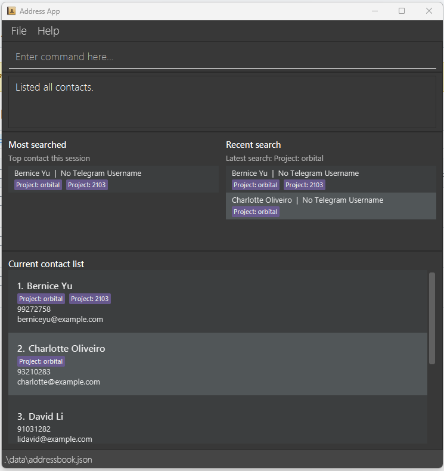

# LinkUp

**LinkUp is a desktop address book for students who manage contacts across multiple projects and teams.**

It helps students organise their project mates' contact details together with relevant project information. This makes it easier to retrieve the right contact quickly and distinguish between people with identical or similar names across different projects.

## Get started

1. Install Java 25.
2. Download `LinkUp.jar` from the [LinkUp releases](https://github.com/AY2627S1-CS2103T-W14-2/tp/releases).
3. Open a terminal in the folder containing the JAR and run `java -jar LinkUp.jar`.
4. Try `list`, `find alex`, or `findproject cs2103` with the supplied sample contacts.

LinkUp saves contacts under `data/addressbook.json` relative to the folder from which you launch it.
See the [User Guide](https://ay2627s1-cs2103t-w14-2.github.io/tp/UserGuide.html) for validation rules,
duplicate-contact handling, and data recovery.

## MVP features

- Save names, international phone numbers, emails, Telegram usernames, and an initial project.
- Allow identical names while rejecting shared phone numbers, emails, or Telegram usernames.
- Find contacts by partial name keywords or a project-name phrase.
- Associate additional projects, delete contacts by displayed index, and undo supported changes during the session.
- Rename projects across contacts, correct their display capitalisation, or merge into an existing project.
- List all contacts, clear the address book, open command help, and exit the app.

The MVP command set is `add`, `list`, `find`, `findproject`, `project`, `delete`, `clear`, `undo`, `help`, and `exit`.
Beyond the MVP, `edit` changes a contact's name, phone number, email or Telegram username, and `sort` orders
contacts by name. Projects are added with `project`, replaced on one contact with `replaceproject`, removed
with `deleteproject`, and renamed or merged across all contacts with `renameproject`.

## UI

The screenshot below shows the LinkUp interface.

## Documentation

Visit the [LinkUp product website](https://ay2627s1-cs2103t-w14-2.github.io/tp/) for project documentation:

- [User Guide](https://ay2627s1-cs2103t-w14-2.github.io/tp/UserGuide.html)
- [Developer Guide](https://ay2627s1-cs2103t-w14-2.github.io/tp/DeveloperGuide.html)
- [LinkUp v1.3 Release Notes](docs/ReleaseNotes.md)
- [About Us](https://ay2627s1-cs2103t-w14-2.github.io/tp/AboutUs.html)

## Acknowledgement
This project is based on the AddressBook-Level3 project created by the [SE-EDU initiative](https://se-education.org)
