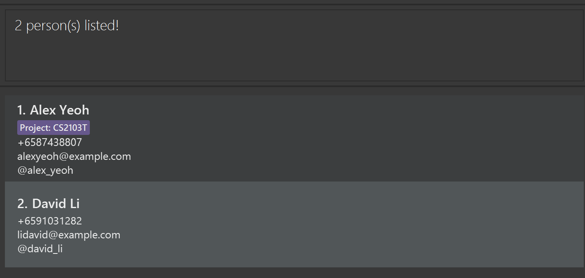

# LinkUp User Guide

LinkUp is a **desktop contact manager for students working across projects and teams**. Type commands to save
contact details, associate project mates with projects, and find the right person by name or project. The contact
list shows phone numbers, emails, Telegram usernames, and projects so you can distinguish people with the same name.

**MVP scope:** `add`, `list`, `find`, `findproject`, `project`, `delete`, `clear`, `undo`, `help`, and `exit`.
Same-name contacts, duplicate-detail checks and automatic saving are included. Beyond the MVP, `edit` changes a
contact's name, phone number, email or Telegram username, and `sort` orders contacts by name; projects are added
with `project`, removed with `deleteproject`, replaced individually with `replaceproject`, and renamed or
merged across contacts with `renameproject`.

<!-- * Table of Contents -->
<page-nav-print />

--------------------------------------------------------------------------------------------------------------------

## Quick start

1. Install Java `25` and check that `java -version` reports version 25 in your terminal.<br>
   **Mac users:** Ensure you have the precise JDK version prescribed [here](https://se-education.org/guides/tutorials/javaInstallationMac.html).

1. Download `LinkUp.jar` from the assets of the [LinkUp release](https://github.com/AY2627S1-CS2103T-W14-2/tp/releases).
   Download the JAR, not the source-code ZIP or TAR archive.

1. Place the JAR in a folder where you have permission to create and update files.

1. Open a terminal, `cd` to the folder containing the JAR file, and run `java -jar LinkUp.jar`.<br>
   Always start from this folder: LinkUp stores data relative to the terminal's current folder. On first launch,
   if no data file exists, LinkUp supplies sample contacts.<br>
   

1. Type a command in the command box and press Enter to execute it. For example, type **`help`** and press Enter to open the help window.<br>
   Some example commands you can try:

   * `list` : Lists all contacts.

   * `add n/John Doe p/+6598765432 e/johnd@example.com tele/@john_doe pr/CS2103T` : Adds John Doe with an initial project.

   * `find John` : Shows contacts whose names contain John.

   * `findproject cs2103` : Shows contacts associated with matching projects.

   * `exit` : Exits the app.

1. Refer to the [Features](#features) section below for details of each command.

Examples in the feature sections are independent illustrations. Use the current displayed index and contact details
that are not already saved. Repeating an `add` example produces a duplicate-contact error.

--------------------------------------------------------------------------------------------------------------------

## Features

<box type="info" seamless>

**Notes about the command format:**<br>

* Words in `UPPER_CASE` are the parameters to be supplied by the user.<br>
  For example, in `add n/NAME`, replace `NAME` with a value such as `John Doe`.

* Items in square brackets are optional.<br>
  For example, `find KEYWORD [MORE_KEYWORDS]` accepts both `find Alice Bob` and `find Alice`.

* Parameters can be in any order.<br>
  For example, if the command specifies `n/NAME p/PHONE_NUMBER`, `p/PHONE_NUMBER n/NAME` is also acceptable.

* Command words and prefixes are case-sensitive: use `findproject`, not `FindProject` or `findp`.
  Separate each prefix from the preceding value with a space. Supply each supported prefix only once.

* `INDEX` always refers to the numbered main person list, including search results. The **Recent search**
  section does not provide command indices. Check the index again after
  adding, editing, deleting, searching, or undoing. Contacts with the same name still have separate indices.

* Extraneous parameters for commands that take no parameters, such as `help`, `list`, `sort`, `exit`, and `clear`, are ignored.<br>
  For example, `help 123` is interpreted as `help`.

* If you are using a PDF version of this document, be careful when copying and pasting commands that span multiple lines as space characters surrounding line-breaks may be omitted when copied over to the application.
</box>

### Viewing recent search results

The **Recent search** section sits above the **Current contact list**, beside **Most searched**.
It shows contacts matching the latest name or project search and scrolls independently. Each result shows a matching contact's name and Telegram handle, with project tags
underneath. Contacts without a Telegram username show `No Telegram Username` beside their name.
For example, a result header reads `Alex Tan | @alex_tan` or `Alex Tan | No Telegram Username`.
Hover over the header to see the full name and handle if the text is too long to fit.

Project tags appear below the header as purple labels such as `Project: Orbital`, using the same styling as
the main person cards. Tags wrap onto additional lines when needed, and results scroll independently to show
all details. Contacts without projects have no project tags. Use the main person list to view phone numbers and emails.

The shared search label appears once above the rows, for example `Latest search: Name: Alex` or
`Latest search: Project: Team Alpha`.
Hover over this text to see the full search if it is too long to fit. Before your first search, it shows
`Latest search: No search yet`.

* Running `find` or `findproject` replaces this section with the latest search results.
  The search text updates automatically and includes `Name:` or `Project:` so you can distinguish search types.
* Running `list` shows all contacts in the main list while keeping the latest results and search text in this section.
* Results stay in sync with contact changes: editing, deleting, adding, clearing, or undoing can change which
  contacts match the latest search and the details displayed.
* Before the first search, the section prompts you to run a name or project search.
  When no contacts match, it shows `No contacts match the latest search.`.
  A search with no matches still displays its search text, so you can check what was searched.
* Invalid search input leaves the previous results and search text unchanged. Recent results and search text
  are cleared when you restart LinkUp.

For example, run `find Alex` and then `list`. The main list shows all contacts, while the smaller section still
shows contacts matching Alex and the label `Latest search: Name: Alex`. Use the indices in the main list for
`edit`, `delete`, and `project`.

### Viewing help: `help`

Opens a window containing a command reference and the User Guide link. Use its copy button to copy the link
into your browser. You can also open help through the Help menu or `F1`.

Format: `help`

The reference lists every command. Resize the help window or scroll to reach later commands and
the Copy URL button.

### Adding a person: `add`

Adds a person to the address book.

Format: `add n/NAME p/PHONE_NUMBER e/EMAIL tele/TELEGRAM_USERNAME pr/PROJECT`

<box type="tip" seamless>

**Tip:** Every new contact must have one initial project. Contacts can have no projects after `deleteproject` or when loaded from older files;
use `project` to associate them with one later.

For a new phone number, enter `+` followed by a country calling code and a national number. The `+` must be
immediately followed by a digit, and the number must end in a digit after surrounding whitespace is trimmed.
You may include spaces or hyphens between digits for readability; LinkUp removes them and stores the number
as `+` followed by 3–15 digits. For example, `+--6591234567` and `+6591234567-` are rejected.
The first digit after `+` cannot be `0`. For example, `p/+65 9123-4567` is stored as `+6591234567`. Bare local
numbers are rejected. LinkUp checks the format only; it does not verify the country calling code or whether the
number is assigned or callable.

Names must contain 1–60 characters after surrounding spaces are removed. English letters, digits, spaces,
apostrophes, hyphens, and periods are accepted; at least one English letter is required. The name keeps its
capitalization for display.

Emails need exactly one `@` and at least two dot-separated domain labels. The local part accepts English letters,
digits, and the unquoted symbols ``!#$%&'*+/=?^_`{|}~-``; periods must separate non-empty parts.
Domain labels contain English letters and digits, with hyphens allowed only inside a label. Surrounding whitespace
is trimmed before validation. Internal whitespace, surrounding
punctuation such as a copied comma, and prefixes such as `mailto:` are rejected. Newly entered emails are stored
in lowercase.

The Telegram username is required. It must contain 5–32 Latin letters, digits, or underscores. A leading `@` is
optional, and uppercase letters are accepted. The username is stored in lowercase and displayed with a leading `@`.

The project is required. A project name must contain 1–40 characters and cannot contain line breaks or other
control characters. Surrounding whitespace is removed, repeated internal whitespace is collapsed, and project
names are compared case-insensitively. Supply exactly one non-empty `pr/PROJECT`. If `pr/` is missing, the
command reports `Project is required. Use pr/PROJECT.`

In `add`, a space followed by `a/` or `t/` is treated as a retired field prefix, even within a project name.
For example, `pr/Team a/b` is rejected. Other punctuation and symbols such as `*()!%$#&` are accepted.
</box>

Examples:
* `add n/John Doe p/+6598765432 e/johnd@example.com tele/@john_doe pr/CS2103T`
* `add n/Betsy Crowe e/betsycrowe@example.com tele/betsy_crowe p/+60123457878 pr/Orbital`

After a successful add, LinkUp confirms the contact and its initial project, for example:
`Added contact: John Doe [CS2103T]`

<box type="info" seamless>

**Duplicate contacts:** Each phone number, email and Telegram username can belong to only one contact.
Emails and Telegram usernames are compared ignoring case, so `Alex@Example.com` and `alex@example.com` count as
the same email. Contacts may share a name or a project. To tell contacts with the same name apart, compare their
phone numbers, emails, Telegram usernames and projects in the contact list.

If a detail is already used, LinkUp rejects the command, saves nothing, and names the clashing detail and contact:
* `Phone number +6587438807 is already used by Alex Yeoh. Please enter a different phone number.`
* `Email alexyeoh@example.com is already used by Alex Yeoh. Please enter a different email.`
* `Telegram username @alex_yeoh is already used by Alex Yeoh. Please enter a different Telegram username.`

LinkUp reports the first conflicting contact in saved order. If several details conflict with that contact,
it reports the phone number first, then email, then Telegram username. Correct the reported detail and try again;
another conflict may then be reported. Empty Telegram usernames on legacy contacts do not conflict.
</box>

Address and tags are no longer contact fields. The `add` and `edit` commands reject `a/` and `t/`; remove those arguments and try again.

### Associating an existing contact with a project: `project`

Adds one project to one or more existing contacts, preserving their other projects and contact details.

Format: `project INDEX [MORE_INDICES] pr/PROJECT`

* `INDEX` is a positive integer referring to the currently displayed contact list, including search results.
* Supply exactly one `pr/PROJECT`. Project names contain 1–40 characters after surrounding whitespace is removed
  and repeated whitespace is collapsed. Line breaks and other control characters are rejected.
* Project comparison ignores capitalisation and normalises whitespace. For example, `Team Alpha` and
  `team   alpha` refer to the same project. Adding an existing association reports an error.
* The new project is appended after existing projects. The current search filter is preserved.
* Missing or invalid indices, missing or blank project names, and repeated `pr/` prefixes are rejected.
  These input errors leave contacts unchanged.
* Project associations are saved automatically. Unlike `add ... pr/PROJECT`, this command updates saved contacts.
* Supply distinct positive indices separated by spaces, for example `project 1 3 5 pr/CS2103T`.
  All indices refer to the displayed list at the start of the command; repeated indices are rejected with a message identifying the repeated index.
* All selected contacts are checked before any changes are applied. If any index is invalid or any
  contact already has the project, the entire command is rejected and undo history is unchanged.
  Duplicate-project errors list every conflicting selected contact by displayed index and name, in input order.
* A successful command appends the project to every selected contact and reports the selected contacts.
  Other contacts are unchanged. One `undo` reverses the entire operation.

Examples:
* With the original sample list displayed, `project 4 pr/Orbital` associates David Li with Orbital.
* `find David` followed by `project 1 pr/CS2103T` adds CS2103T to the first search result.
* `project 1 3 5 pr/CS2103T` adds CS2103T to displayed contacts 1, 3 and 5 as one undoable operation.

### Replacing a contact's project association: `replaceproject`

Replaces one project on one contact, preserving their other details and project order.
Other contacts associated with the old project remain unchanged.

Format: `replaceproject INDEX old/OLD_PROJECT new/NEW_PROJECT`

* `INDEX` is a positive index in the currently displayed list, including search results.
* Both names must contain 1–40 characters. Line breaks and other control characters are not allowed.
  Surrounding whitespace is removed, repeated whitespace is collapsed, and matching ignores case.
* The old project must belong to the selected contact. The new project must not duplicate another
  association on that contact. Capitalization corrections
  are allowed, such as `old/orbital new/Orbital`. A replacement is unchanged only when its normalized
  spelling exactly matches the stored spelling, regardless of how the old name was typed.
* Both prefixes are required exactly once; either prefix order is accepted. Missing, blank or
  invalid names and invalid indices produce an error without changing the contact.
* The replacement keeps the old project's position. The active filter is preserved, so a contact
  may disappear from `findproject` results when its replacement no longer matches.
* Successful changes are saved and can be reversed with `undo`.
* A space followed by `old/` or `new/` is interpreted as a command prefix, so these sequences
  cannot be included literally in a project name in this command.

Example: `replaceproject 1 old/CS2103T new/Orbital` replaces CS2103T with Orbital on the
first displayed contact. The success message identifies the old project, new project and contact.

### Removing a contact's project association: `deleteproject`

Removes one project from one or more selected contacts. The contact and other contacts associated with the same project
remain saved, and the remaining projects retain their order.

Format: `deleteproject INDEX [MORE_INDICES] pr/PROJECT`

* `INDEX` is a positive index in the currently displayed list, including search results.
* The name must contain 1–40 characters. Line breaks and other control characters are not allowed.
  Matching ignores case, removes surrounding whitespace, and collapses repeated whitespace.
* The specified project must belong to every selected contact. Missing or invalid indices, missing or
  invalid project names, and repeated `pr/` prefixes are rejected without changing data or undo history.
* Supply distinct positive indices. All selections are resolved against the displayed list before any updates.
  Repeated-index errors identify the repeated index. If any index is invalid or any selected contact lacks
  the project, the entire batch is rejected without changing contacts or undo history. Missing-association
  errors list all affected selections by displayed index and name; out-of-range indices take precedence.
* One `undo` restores all associations removed by a successful batch.
* Removing the last project is allowed and leaves the contact with no projects.
* The current search filter is preserved. A contact may disappear from `findproject` results after removal.
* Successful removal is saved and can be reversed with `undo`.

Example: `deleteproject 1 pr/CS2103T` removes CS2103T from the first displayed contact.
Use `deleteproject 1 3 5 pr/CS2103T` to remove the association from three displayed contacts.
The success message identifies the project and selected contacts.

### Listing all persons: `list`

Shows a list of all persons in the address book.

Clears the current search filter. Shows `Listed all contacts.` when contacts exist, or `No contacts saved yet.`
when the list is empty. The **Recent search** section retains the latest search results.

Format: `list`

### Sorting contacts by name: `sort`

Sorts all saved contacts alphabetically by name and saves the new order.

Format: `sort`

* Names are compared ignoring case, so `alex Tan` comes before `Bernice Yu`. Names that differ only in case are
  ordered by their exact spelling, and contacts with the same name are ordered by phone number, so the result is
  always the same.
* Names are compared character by character, so `Alex 10` comes before `Alex 2`.
* The new order is saved and kept after you restart LinkUp. Contacts you add later are placed at the end until
  you sort again.
* All contacts are sorted, even those hidden by a search. If search results are showing, they stay on screen,
  now in sorted order.
* Indices follow the new order, so check them again before using `edit`, `delete` or `project`.
* On success, LinkUp shows `Sorted N contact(s) by name.`, where N is the number of saved contacts.
* If the contacts are already in order, LinkUp shows `Contacts are already sorted by name.`. If there are no
  contacts, it shows `No contacts saved yet.`. Neither case changes anything or adds an undo entry.
* `undo` restores the previous order.

Examples:
* `sort` puts the whole contact list in name order.
* `find alex` followed by `sort` sorts all contacts and keeps showing the contacts named Alex, now in name order.

### Renaming or merging a project: `renameproject`

Renames a project across **all saved contacts**, including contacts hidden by a search. Contact details and
unrelated projects are preserved. Use `replaceproject` to change an association on just one contact.

Format: `renameproject old/OLD_NAME new/NEW_NAME`

* Supply each prefix exactly once, in either order, with a non-empty value and no index or other preamble.
* Project names must contain 1–40 characters after surrounding and repeated whitespace is cleaned up.
* Source matching is exact and case-insensitive: `Orbital` matches `orbital`, but not `Orbital Team B`.
* If the destination is new, the new name keeps the source's position in each project list.
* Case-only changes, such as `orbital` to `Orbital`, update the displayed spelling across all matching
  associations. If every association already has the requested spelling, the command reports
  `No changes made.` without saving or adding an undo entry.
* An unknown source produces an error and changes nothing.
* The current search filter is preserved. Contacts may enter or leave `findproject` results when their
  renamed projects start or stop matching the search. Contacts hidden by the filter are still updated.
* Successful changes are saved automatically. The message reports the number of contacts actually changed.
  One `undo` reverses the entire rename or merge, including original capitalisation and project order.
* Quotation marks and backslashes are literal characters. For example, `old/"CS2103T"` matches only a
  project whose name includes the quotation marks; it does not match `CS2103T`.
* As with `replaceproject`, a space followed by `old/` or `new/` is a command prefix. These sequences
  cannot appear literally inside a name in this command; adding quotation marks does not escape them.

**Merging into an existing project**

If a different destination project already exists (ignoring case), the command merges immediately.
If a contact belongs to both projects, the destination stays in its existing position and the source is removed.
All destination associations use the requested spelling, including on contacts that did not belong to the
source. Each changed contact is counted once. The success message reminds you to use `undo` to reverse it.

Examples:

* `renameproject old/CS2103T new/CS2103T Team 2` renames to a new project name.
* `renameproject old/orbital new/Orbital` standardises display capitalisation.
* If `orbital` already exists, `renameproject old/CS2103T new/Orbital` merges both projects in one submission.

Like other commands that change contacts, rename updates the current session before saving. If saving fails,
the change remains in memory with an undo entry. Correct the storage problem, then use `undo` to restore the
previous state or another successful command to save the current state.

### Editing a person: `edit`

Changes the name, phone number, email or Telegram username of an existing contact.

Format: `edit INDEX [n/NAME] [p/PHONE_NUMBER] [e/EMAIL] [tele/TELEGRAM_USERNAME]`

* `INDEX` refers to the currently displayed list, including search results, and must be a positive integer
  within that list.
* Supply at least one field. Fields can be given in any order, so `edit 1 tele/@alice_tan n/Alice` and
  `edit 1 n/Alice tele/@alice_tan` are the same command.
* Only the fields you supply change. All other details, including every project and their order, stay exactly
  as they are. Contacts saved by older versions without a Telegram username can still have other fields edited.
* Values follow the same rules and formatting as [`add`](#adding-a-person-add): phone numbers need `+` and a
  country code, new emails are stored in lowercase, and Telegram usernames are stored in lowercase without `@`.
* A field cannot be left blank or cleared. For example, `edit 1 n/Weien tele/` is rejected as a whole, and the
  name does not change either.
* Each prefix can appear only once. `edit 1 n/Al n/Al` is rejected, even though both values are the same.
* Projects cannot be edited. Supplying `pr/` rejects the whole command with
  `Projects cannot be edited with edit. Use project INDEX pr/PROJECT to add an association.`
  Use `replaceproject` to replace one association, `deleteproject` to remove associations, or `renameproject`
  to rename across all contacts. Address (`a/`) and tags (`t/`) are no longer supported either.
* The new phone number, email and Telegram username must not belong to any other contact, including contacts
  hidden by a search, following the same [duplicate-contact rule](#adding-a-person-add) as `add`. You can keep
  a contact's own details, and you can give a contact the same name as another contact.
* If any part of the command is invalid, nothing changes: the contact, the current search results, the saved
  data and the undo history all stay as they were. LinkUp reports one error at a time.
* If the command would leave the contact exactly as it is, LinkUp shows `No changes made.` and keeps the current
  search results. This does not count as a change for `undo`.
* After a successful edit, LinkUp shows `Edited contact: ` followed by the contact's details, and displays all
  contacts again, clearing the previous search filter.

Examples:
*  `edit 1 p/+6591234567 e/johndoe@example.com` changes the phone number and email of the 1st contact to
   `+6591234567` and `johndoe@example.com`.
*  `edit 2 n/Betsy Crower tele/@betsy_crower` changes the name and Telegram username of the 2nd contact.
*  `find Bernice` followed by `edit 1 tele/@bernice_yu2` changes the Telegram username of the first search result.

### Locating persons by name: `find`

Finds persons whose names contain any of the given keywords.

Format: `find KEYWORD [MORE_KEYWORDS]`

* The search is case-insensitive; for example, `hans` matches `Hans`.
* Keyword order does not matter; for example, `Hans Bo` matches `Bo Hans`.
* The search considers only names.
* Partial words match anywhere in a name; for example, `Han` matches `Hans`, and `LEX` matches `Alex`.
* Persons matching at least one keyword are returned (an `OR` search); for example, `Hans Bo` returns `Hans Gruber` and `Bo Yang`.
* Keywords are separated by whitespace. The entire search input must contain 1–60 characters after
  trimming surrounding whitespace. Internal spaces count towards this limit, including repeated spaces.
* Every search checks all saved contacts and replaces the previous results. Each matching contact appears once,
  in the existing contact order, with its contact details and projects. Use `list` to show all contacts again.
* No matches produces an empty list and the message `0 person(s) listed!`.
* Successful searches report `N person(s) listed!`, where N is the number of matching contacts.
* The [Recent search results](#viewing-recent-search-results) section also shows matching contacts and their details
  and keeps them visible after `list`.
* Blank or overlong input produces an error without changing the current results or saved contacts.
* The two search sections sit side by side above the **Current contact list**. **Most searched** on the left
  shows the **Top contact this session**. **Recent search** on the right shows the latest query and its matches.
  The **Current contact list** below provides the numbered contacts for commands.
  Each successful `find` or `findproject` adds one search to every matching person, even if several keywords
  or projects match that person. The displayed contact details include their name, projects and Telegram username.
  The person with the highest count is displayed. In a draw, the person matched by the more recent search wins;
  if both matched the same search, the person first in the contact list wins. For example, `find Alice` followed
  by `find Benson` gives both one search, so Benson wins. Another `find Alice` puts Alice ahead with two.
* **Latest search** shows the latest executed search with its type: `Name: Alice` for `find Alice` or
  `Project: Orbital` for `findproject Orbital`, including searches with no matches. A search with
  no matches does not change anyone's count or tie priority. Invalid searches leave the sections unchanged.
  If saving reports an error, the latest search label follows the results already displayed, but search counts
  do not increase. `list` and other commands do not add search counts.
* Editing a contact or adding a project preserves their count and search recency; their displayed details update
  immediately. Undoing an edit or project change also preserves these statistics. Deleting a contact removes
  their count; `clear` removes all counts. Undoing deletion or clearing restores contacts without their old counts.
  These commands leave the recent search text unchanged.
* Both search sections reset when you restart LinkUp. Before any contact earns a search count, the most searched
  section shows `No contacts searched yet.`. Long contact headers and queries use an ellipsis; hover over them
  to read the full text. Project tags wrap below the contact header. Only one most searched contact is shown,
  and its details scroll when needed.

Examples:
* `find John` returns `john` and `John Doe`
* `find ale` returns contacts such as `Alex Tan` and `Alexander Lee`.
* `find alex david` returns `Alex Yeoh`, `David Li`<br>
  

### Finding contacts by project: `findproject`

Finds contacts associated with projects whose names contain the given phrase.

Format: `findproject KEYWORD`

* Matching is case-insensitive and partial: `cs2103` matches `CS2103T`.
* The entire keyword is one phrase. `team alpha` matches `CS2103T Team Alpha`, but does not match
  `Team Beta`, `Alpha Team`, or separate projects named `Team` and `Alpha`.
* Surrounding whitespace is ignored and repeated internal whitespace is treated as a single space when matching.
* The keyword must contain 1–40 characters after trimming surrounding whitespace. Internal spaces count towards
  this limit before they are collapsed.
* Any associated project can match. Each contact appears once, with its contact details and projects, in the
  existing contact order. Contacts with no projects are excluded.
* Every search checks all saved contacts and replaces the previous search results. Use `list` to show all contacts again.
* Matching contacts are displayed with the message `Found N contact(s) matching the project keyword.`
  If nothing matches, the displayed list is empty and the message is `No contacts found for the project keyword.`
* The [Recent search results](#viewing-recent-search-results) section also updates to this search, replacing any
  previous name or project search results.
* Blank or excessively long keywords produce an error and leave the current results and saved contacts unchanged.

Examples:

* `findproject cs2103` finds contacts in projects such as `CS2103T` and `CS2103T Team Alpha`.
* `findproject team alpha` finds contacts whose project names contain the phrase `team alpha`, ignoring case.
* `findproject orbital` followed by `delete 1` deletes the first contact in those search results.

### Listing all projects: `projects`

Shows every project saved in LinkUp, with the number of contacts associated with each.

Format: `projects`

* The command takes **no parameters**. Surrounding spaces are allowed, but anything else after `projects` is
  rejected with `Invalid command format!` followed by this command's usage. For example, `projects 2 pr/Orbital`
  is rejected rather than treated as `projects`, so a mistyped `project 2 pr/Orbital` cannot be mistaken for success.
* All saved contacts are counted, including contacts hidden by `find` or `findproject`. The displayed contact
  list and its search filter stay unchanged.
* Projects that differ only in letter case, such as `CS2103T tP` and `cs2103t TP`, count as one project. It is shown
  with the spelling of the first contact that has it, in saved contact order.
* Projects are sorted by comparing their names after conversion to lowercase. This is not language-specific
  dictionary ordering; for example, `#Team` appears before `Alpha`, while `~Team`, `Élan`, and `数据` appear
  after `Zeta`.
* Each project is shown on its own line as `- PROJECT (N contacts)`, or `(1 contact)` for a single contact.
  The lines have no index numbers: `INDEX` in other commands always refers to a contact, never to a project.
* The first line reads `Listed N projects across all contacts:` (or `Listed 1 project across all contacts:`).
* Contacts without any projects are not counted. If no contact has a project, the message is
  `No projects saved yet.`
* The list appears in the result box below the command box. Scroll the result box if there are more projects than
  fit in it.
* `projects` does not change any contact and does not add an `undo` entry.

Examples:

* With contacts in `Orbital`, `CS2101 OP` and `Hackathon 2026`, `projects` shows:
  ```
  Listed 3 projects across all contacts:
  - CS2101 OP (2 contacts)
  - Hackathon 2026 (1 contact)
  - Orbital (3 contacts)
  ```
* `projects` followed by `findproject hackathon 2026` shows the contacts whose project names contain
  `hackathon 2026`, ignoring case.

### Deleting a person: `delete`

Deletes the specified person from the address book.

Format: `delete INDEX`

* Deletes the person at the specified `INDEX`.
* The index refers to the index number shown in the displayed person list.
* The index **must be a positive integer** 1, 2, 3, ...
* Only the selected contact is removed, even if others have the same name. The current search filter is preserved.
* Deletion takes effect immediately without a confirmation prompt. Use `undo` in the same session to reverse it.

Examples:
* `list` followed by `delete 2` deletes the 2nd person in the address book.
* `find Betsy` followed by `delete 1` deletes the 1st person in the results of the `find` command.

### Clearing all entries: `clear`

Clears all entries from the address book.

This removes **all contacts**, including those hidden by a search filter, without a confirmation prompt.
Use `undo` before closing the application if you need to restore them.

Format: `clear`

### Undo a command: `undo`

Undo the last supported command. The supported commands are:
* `add`
* `delete`
* `edit`
* `clear`
* `project`
* `replaceproject`
* `renameproject` (the entire rename or merge)
* `sort`
* `deleteproject`

Each `undo` reverses the most recent successful supported command that has not already been undone.
Enter `undo` repeatedly to reverse multiple commands in reverse execution order. Commands rejected for invalid
input or duplicate details do not affect the undo history, and neither does an `edit` that reports
`No changes made.`. Commands such as `find`, `findproject`, `projects`, `list`, and `help` do not add undo entries.
A successful undo displays all contacts again.

Undo history is available only during the current application session and is cleared on restart.
If there are no commands left to undo, the application reports `No command to undo.`
Redo is not supported.

Format: `undo`

### Exiting the program: `exit`

Exits the program.

Format: `exit`

### Saving the data

LinkUp automatically attempts to save after each successfully executed command, including searches and `list`.
Commands rejected during parsing or validation do not save. There is no separate save command.

The data file is `data/addressbook.json` relative to the folder from which you launch LinkUp. The status bar shows
the data location. Window settings are saved separately in `preferences.json` in the launch folder.

If a save error appears, the displayed contact list may already contain your change even though it was not saved.
Keep the application open, correct the storage or permission problem, then run `list` to retry saving the current
contacts. Do not repeat an `add` blindly, as the contact may already be in the list. If you want to reverse the change,
use `undo` after fixing storage. An undo that cannot save leaves the contacts and undo history unchanged and can be retried.

When loading an older data file, LinkUp ignores the retired address and tag fields. Contacts without a
Telegram username or project still load. Previously saved names and emails also retain their original spelling and
case when accepted by the legacy loading rules, even if they do not meet today's input rules.
Previously saved local phone numbers also load unchanged.
Before the first save that removes address or tags, LinkUp creates a
backup beside the original file, named `<original filename>.pre-v1.3-<unique suffix>.bak`. The backup preserves
the original file exactly. New saves omit address and tags; later saves of the updated file do not create more
migration backups. Importing another old file creates a separate backup. If the backup cannot be written,
LinkUp reports a save error and leaves the original file untouched.

To recover the old file, close LinkUp and copy the backup over the original data file. Keep the backup if you
want to retain address/tag values: the updated app no longer displays or edits them.

### Editing the data file

Advanced users can edit `data/addressbook.json` in the launch folder. Close LinkUp first and make a copy of the
file before editing. Changes must satisfy the saved-data validation and duplicate-contact rules.

In JSON, write international phone numbers in the saved format, such as `"+6591234567"`, without spaces or
hyphens. The command input `p/+65 9123-4567` is normalized before saving; that formatted string is not accepted
directly in JSON. Older digit-only numbers such as `"91234567"` remain loadable and are preserved exactly.
LinkUp does not infer a country code, so `91234567` and `+6591234567` are different stored phone values.

<box type="warning" seamless>

**Caution:**
If your changes make the data file invalid, LinkUp starts with an empty contact list at the next run. Before
starting, it copies the invalid file to a backup beside it, named `<original filename>.unreadable-<unique suffix>.bak`.
The next successfully executed command attempts to save the current contact list over the original file.
To recover, close LinkUp, fix the problem in the backup, and copy it over the original data file. If the
backup cannot be created (for example, because the disk is full or the folder is read-only), LinkUp shows an
error and does not start, so that your data file is never overwritten. Copy the data file somewhere safe, fix the
storage or permission problem, then start LinkUp again. Still, we recommend backing up the file yourself before
editing it.<br>
A file in which two contacts share a phone number, email or Telegram username breaks the
[duplicate-contact rule](#adding-a-person-add) and is also rejected on load.<br>
Use commands for ordinary changes; manual file editing is intended for users familiar with JSON and the validation rules.
</box>

--------------------------------------------------------------------------------------------------------------------

## FAQ

**Q**: How do I transfer my data to another computer?<br>
**A**: Close LinkUp on both computers. Copy `data/addressbook.json` from the old launch folder into the `data`
folder in the new launch folder, backing up any existing destination file first. Launch LinkUp from that new folder.

**Q**: Why do I see sample contacts instead of my saved contacts?<br>
**A**: LinkUp supplies sample data when it cannot find a data file at the expected path. Check the status bar and
launch it from the same folder you used previously. A different terminal folder means a different data location.

**Q**: Why does a phone number from an old file fail when I type it into `edit`?<br>
**A**: Legacy digit-only phone numbers remain loadable, but newly entered numbers require `+` and a country code.
For example, enter `p/+6591234567` rather than `p/91234567`.

--------------------------------------------------------------------------------------------------------------------

## Known issues

1. **When using multiple screens**, if you move the application to a secondary screen, and later switch to using only the primary screen, the GUI will open off-screen. The remedy is to delete the `preferences.json` file created by the application before running the application again.
2. **If you minimize the Help Window** and then run the `help` command (or use the `Help` menu, or the keyboard shortcut `F1`) again, the original Help Window will remain minimized, and no new Help Window will appear. The remedy is to manually restore the minimized Help Window.

--------------------------------------------------------------------------------------------------------------------

## Command summary

Action     | Format, Examples
-----------|----------------------------------------------------------------------------------------------------------------------------------------------------------------------
**Add**    | `add n/NAME p/PHONE_NUMBER e/EMAIL tele/TELEGRAM_USERNAME pr/PROJECT ` <br> e.g., `add n/James Ho p/+6522224444 e/jamesho@example.com tele/james_ho pr/CS2103T`
**Clear**  | `clear`
**Delete** | `delete INDEX`<br> e.g., `delete 3`
**Edit**   | `edit INDEX [n/NAME] [p/PHONE_NUMBER] [e/EMAIL] [tele/TELEGRAM_USERNAME]`<br> e.g., `edit 2 n/James Lee e/jameslee@example.com tele/@james_lee`
**Find**   | `find KEYWORD [MORE_KEYWORDS]`<br> e.g., `find James Jake`
**Find by project** | `findproject KEYWORD`<br> e.g., `findproject team alpha`
**List**   | `list`
**Rename project** | `renameproject old/OLD_NAME new/NEW_NAME`<br> e.g., `renameproject old/CS2103T new/Orbital`
**Replace project** | `replaceproject INDEX old/OLD_PROJECT new/NEW_PROJECT`<br> e.g., `replaceproject 1 old/CS2103T new/Orbital`
**Sort**   | `sort`
**Delete project** | `deleteproject INDEX [MORE_INDICES] pr/PROJECT`<br> e.g., `deleteproject 1 pr/CS2103T`
**Project** | `project INDEX [MORE_INDICES] pr/PROJECT`<br> e.g., `project 1 pr/Orbital`
**List projects** | `projects`
**Help**   | `help`
**Undo**   | `undo`
**Exit**   | `exit`
